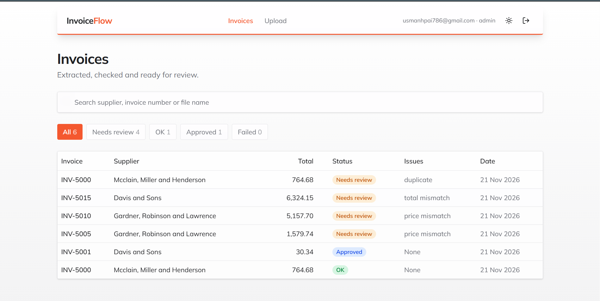
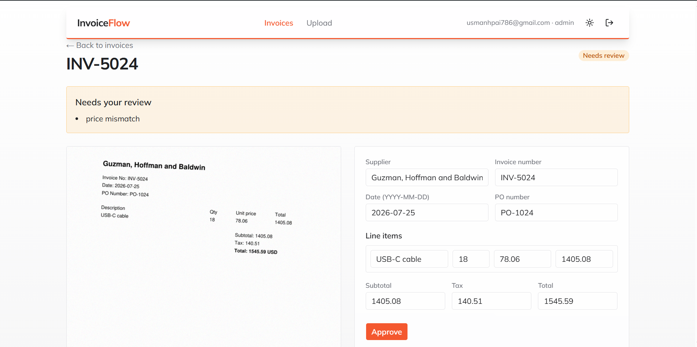
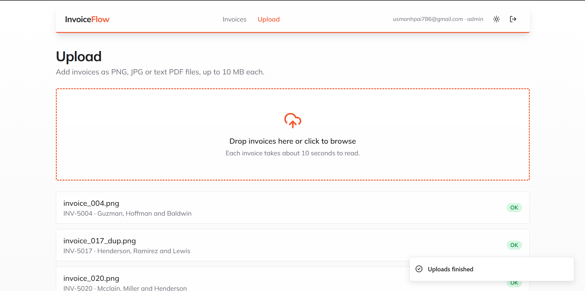

# InvoiceFlow

[](https://github.com/usman007w/InvoiceFlow/actions/workflows/ci.yml)

AI-assisted invoice processing: upload a scanned invoice, extract the data, check it, and flag problems for a human reviewer. Built with a security-focused backend, automated tests and Docker.



## What it does

Businesses receive supplier invoices as PDFs or photos, and someone has to type them into a spreadsheet, check them against the purchase order, and spot mistakes and duplicate bills. InvoiceFlow automates that:

1. Upload an invoice (PNG, JPG or text PDF).
2. OCR reads the text, and an LLM extracts structured fields (validated against a Pydantic schema).
3. Validation checks the math and repairs quantities that OCR dropped, using the invoice's own totals.
4. Reconciliation compares the invoice with its purchase order and flags price or quantity differences, and detects duplicate invoices.
5. A reviewer sees only the flagged invoices, fixes them next to the original document, and approves. Approval is blocked while issues remain.

```
Upload -> file checks -> OCR -> LLM extraction -> schema validation
      -> math check + repair -> PO reconciliation + duplicate check
      -> review (human) -> approved
```

## Screenshots

| Review page | Upload |
|---|---|
|  |  |

## Results

Measured on **65 synthetic scanned invoices** with planted errors (generated by `backend/scripts/generate_data.py`, then degraded with rotation, blur and noise).

| Stage | Result |
|---|---|
| Regex baseline on scanned images | 0/65 |
| OCR + LLM, raw line items | 45/65 |
| OCR + LLM + math check and repair | 65/65 |
| Header fields, end to end | 65/65 |
| Wrong totals caught | 8/8 |
| Price mismatches vs purchase order caught | 6/6 |
| Duplicate invoices caught | 5/5 |
| Clean invoices falsely flagged | 0/46 |
| Silent errors (wrong and not flagged) | 0 |

**Important:** this is synthetic, clean data with mild scan noise. Real invoices (discounts, shipping, varied layouts, handwriting) will be harder, and accuracy on real documents has not been measured.

The raw LLM misses line items mostly because Tesseract drops a quantity. The math check (quantity x unit price = line total) repairs those from the document's own numbers, and anything it cannot repair is flagged instead of guessed.

## Security

Run on every push in CI:

| Attack tried | Result |
|---|---|
| Request without login | 401 |
| Forged or unsigned token | 401 |
| Viewer uploads, approves or creates users | 403 |
| Company B reads or edits company A's invoice or file | 404 |
| Wrong password vs unknown email | Identical response |
| Repeated wrong passwords | Account locked (429) |
| Fake PDF, oversized file | 415, 413 |
| Weak password or invalid role | 422 |
| Approve an invoice with open issues | 409 |
| Audit log leaks other companies' events or passwords | No |

Design: argon2 password hashing, JWT in an `HttpOnly` `SameSite=Strict` cookie, roles (admin, reviewer, viewer), every query filtered by company, file type checked by content (not extension), uploads stored under random names, document text treated as untrusted input for the LLM, an audit log of logins, uploads, edits and approvals, and no public signup (the first admin is created from the command line).

## Stack

Python, FastAPI, SQLAlchemy, SQLite, Pydantic, Tesseract OCR, Groq LLM API, Next.js, TypeScript, Tailwind CSS, shadcn/ui, Docker Compose, Caddy, GitHub Actions, pytest, ruff.

## Run it with Docker

Requirements: Docker Desktop and a free Groq API key.

```bash
git clone https://github.com/usman007w/InvoiceFlow.git
cd InvoiceFlow
```

Create `backend/.env` (never commit it):

```
GROQ_API_KEY=your_key_here
JWT_SECRET=a_random_string_of_at_least_32_characters
```

Then:

```bash
docker compose up -d --build
docker compose exec backend python -m scripts.create_admin "Demo Co" you@example.com
docker compose exec backend python -m scripts.load_pos "Demo Co"
```

Open http://127.0.0.1 and sign in. Sample scanned invoices can be generated with the scripts below.

## Run the tests

```bash
cd backend
pip install -r requirements.txt pytest httpx ruff
ruff check . --select E9,F
pytest -q
```

The tests never call the LLM and use a temporary database.

## Reproduce the evaluation

```bash
cd backend
python scripts/generate_data.py
python scripts/make_scanned_set.py
python -m scripts.eval_baseline scanned
python -m scripts.eval_pipeline      # calls the Groq API, results cached
python -m scripts.eval_e2e
python -m scripts.eval_reconcile
```

Tesseract must be installed locally for the OCR steps.

## Known limitations

- Evaluated on synthetic invoices only; no real-world accuracy figure yet.
- Scanned PDFs are not supported (images and text PDFs only).
- SQLite database, single server. No migrations tool yet.
- Stored files are not encrypted at rest, and invoice text is sent to the LLM provider. Do not use real confidential documents without masking personal data or using a local model.
- The repair rule assumes line total = quantity x unit price, so invoices with discounts need extra rules.
- CI only. No automatic deployment yet.

## Roadmap

- Chat agent for questions about the invoice data
- PostgreSQL and migrations
- Encryption at rest and PII masking before LLM calls
- Fuzzy matching for supplier and item names
- Testing on real, anonymized invoices
- Deployment with a domain and HTTPS